# MYSQL_PROJECT:THE BILLIONAIRE WEALTH INVESTIGATION

## Business Scenario
You have been employed as a Junior Data Analyst by a global financial research organisation.
The organisation wants to understand wealth distribution among the world’s 200 richest people.
Your responsibility is to analyse the dataset and provide answers to important business questions
using SQL.

## About Dataset
The Top 200 Richest World's Billionaires Dataset provides a detailed overview of the wealthiest
individuals globally, according to the Forbes list. This dataset captures essential information
about the top 200 billionaires, offering insights into their financial standing, age, industry, and
more. It is a valuable resource for analyzing trends in wealth distribution, industry dominance,
and the demographics of the world's richest people.
## Column Descriptions
• Serial Number: Sequential numbering of the billionaires in the dataset.
• Rank: The global ranking of the billionaire based on their net worth as per the Forbes list.
• Name: The name of the billionaire.
• Age: The age of the billionaire.
• Country: The name of the country to which they belong.
• Net worth (In Billion Dollars): The total net worth of the billionaire, expressed in billions
of dollars.
• Industry: The industry or sector to which the billionaire's wealth is primarily attributed.
This is a project provides a detailed overview on top 200 richest World's Billionaires individuals globally, according to the Forbes list. 

## Business Questions

## 1. Retrieve the 20 richest billionaires.
  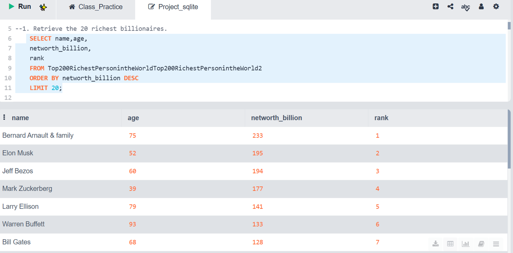 
  
  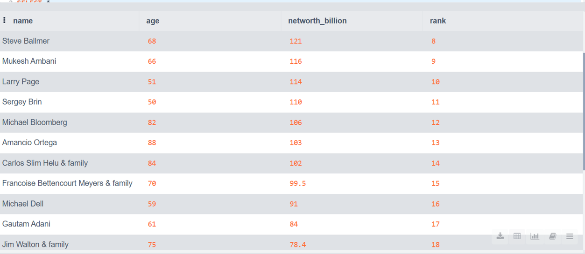
  

## 2. Identify the five youngest billionaires.
  
 
## 3.  Calculate the average age and average net worth.
  
  .PNG) 
  
## 4.Identify the five most represented countries.
 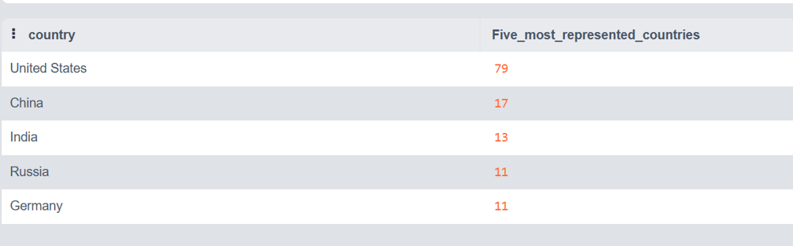 
 
## 5.  Calculate the combined net worth of billionaires from each country.
 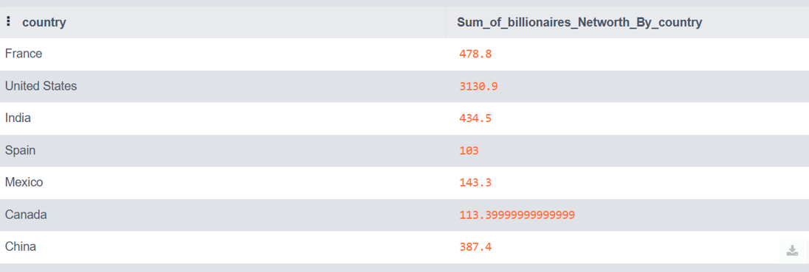 
  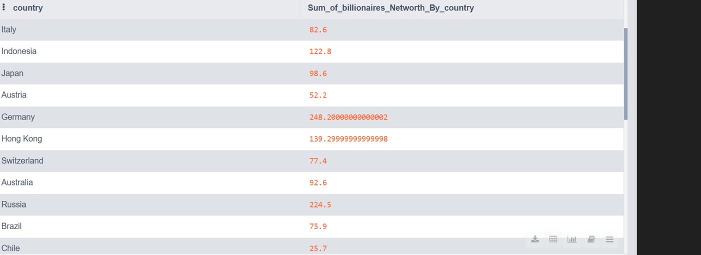 
    
    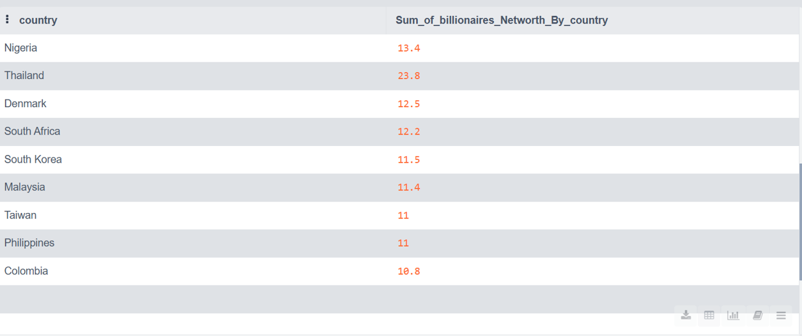 
    
## 6.Identify the five industries with the highest number of billionaires.
  
 
## 7. Find countries with at least five billionaires.
 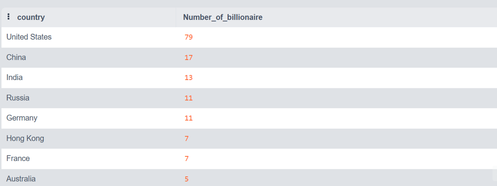
 
## 8. Calculate the total wealth of billionaires younger than 50.
 
 
## 9.  Identify billionaires whose net worth exceeds the overall average net worth.
 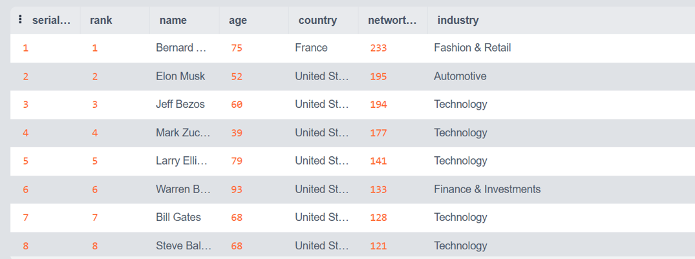
 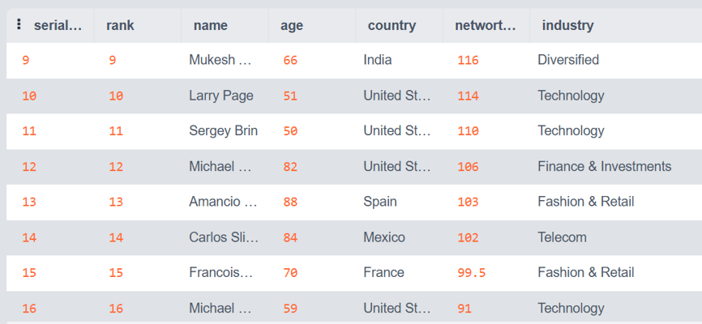 
  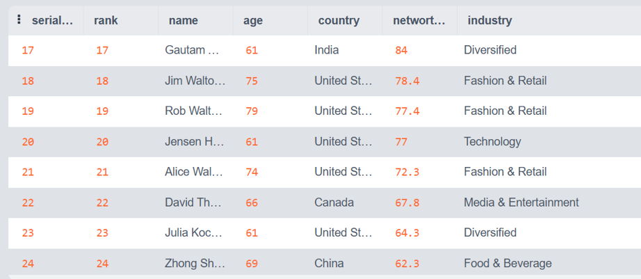 
   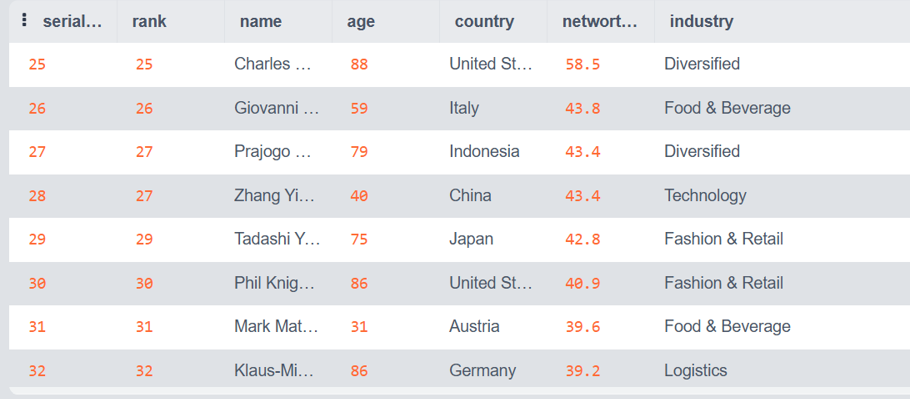 
    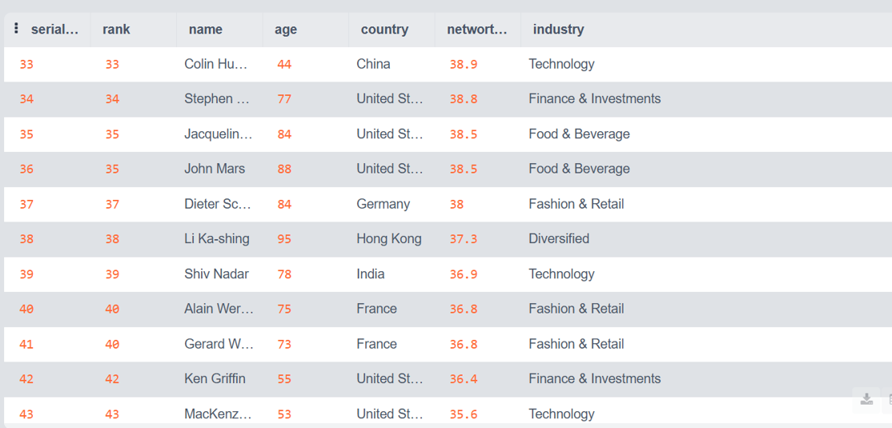
     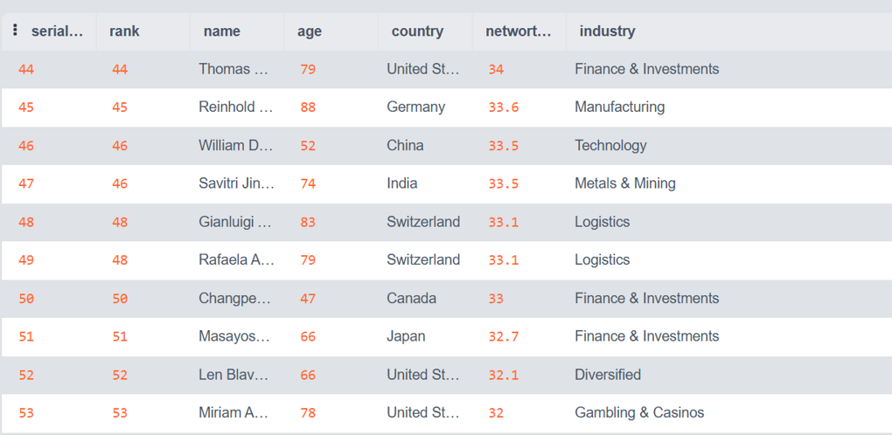 
      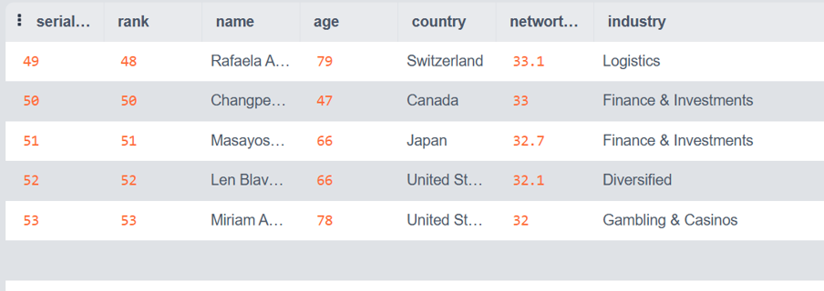 
## 10.Identify the industry with the highest average net worth.
 

 ## 11. Which industry has the wealthiest billionaire?
 
 
## 12. Which country has the highest combined billionaire wealth?
  
## 13. Which country has the highest average billionaire net worth?
 
## 14. Which industries have at least 10 billionaires?
 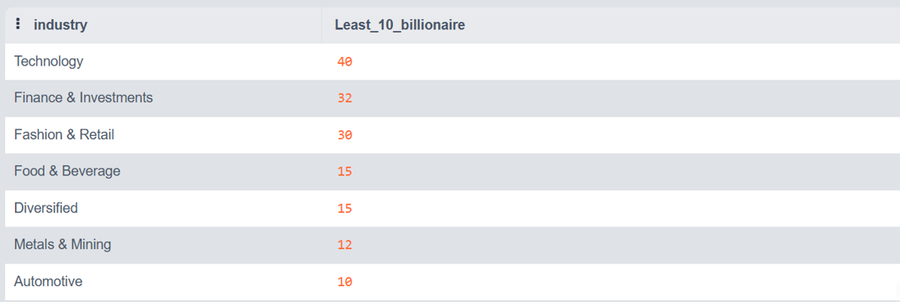
 
## 15. How many billionaires have a net worth above $50 billion?
 
 
## 16. What percentage of the dataset is made up of billionaires younger than 50?
 

## 17. Who has a net worth between $50 billion and $100 billion?
 
 
## 18. Which country has the highest number of billionaires below age 40?
 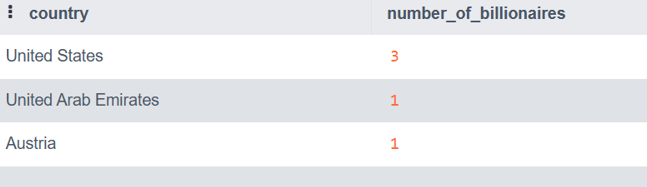 
     
## 19. Which industry contributes the most to the combined wealth of the top 200?
 
    
## 20. What is the difference between the richest and poorest billionaire in the dataset?
 
 
## 21. What is the average net worth of billionaires aged above 70?
  
     
## 22. Which billionaires belong to industries with more than 10 representatives?
 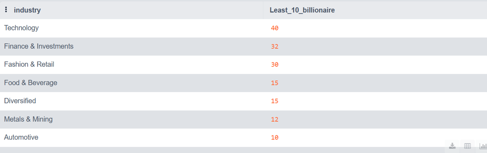
