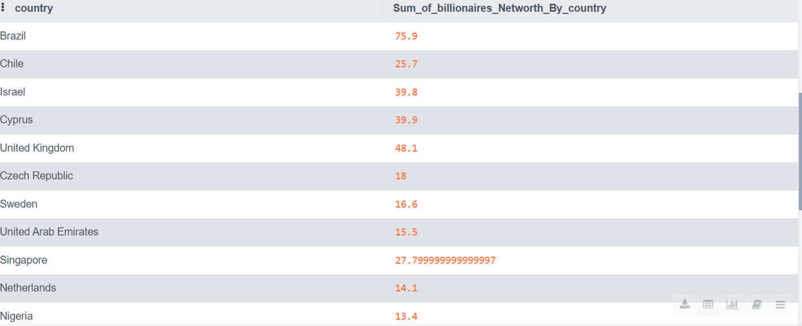

# Mysql_Project on Top200 Richest Worlds Billionaire
This is a project provides a detailed overview on top 200 richest World's Billionaires individuals globally, according to the Forbes list. 

## Business Questions
## 1. Retrieve the 20 richest billionaires.
   
  
  
  
## 2. Identify the five youngest billionaires.
  
## 3.  Calculate the average age and average net worth.
  
  .PNG) 
## 4.Identify the five most represented countries.
  
## 5.  Calculate the combined net worth of billionaires from each country.
  
   
    
     
## 6.Identify the five industries with the highest number of billionaires.
  
## 7. Find countries with at least five billionaires.
 
## 8. Calculate the total wealth of billionaires younger than 50.
 
## 9.  Identify billionaires whose net worth exceeds the overall average net worth.
 
## 10.Identify the industry with the highest average net worth.
 

